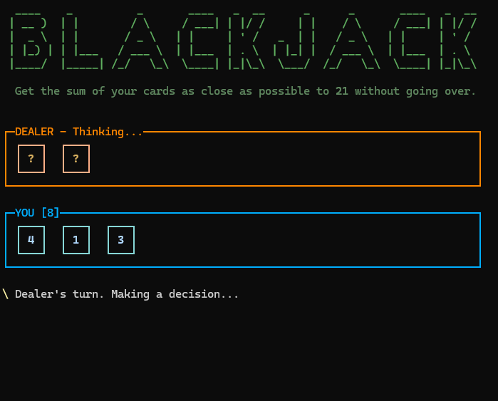

This project is a school assignment for a C# course. It's a basic Blackjack game, created as a C# console application with JetBrains Rider and the [Spectre.Console](https://spectreconsole.net) library for nicer console output.

